# MyClubs — HackUMass 2026

**Find the clubs that actually fit your week — right where you already check your classes.**

MyClubs is a prototype that adds an extracurricular layer to a Canvas-style dashboard. Students discover real UMass
Amherst organizations, see which ones fit around their class schedule, and plan academics and campus life in one
calendar that flags real time conflicts.

> Independent hackathon prototype. Not affiliated with, endorsed by, or connected to UMass Amherst or Instructure Canvas.
> Clubs and verified events come from public Campus Pulse listings; courses, the class schedule, deadlines and sample
> events are demo data.

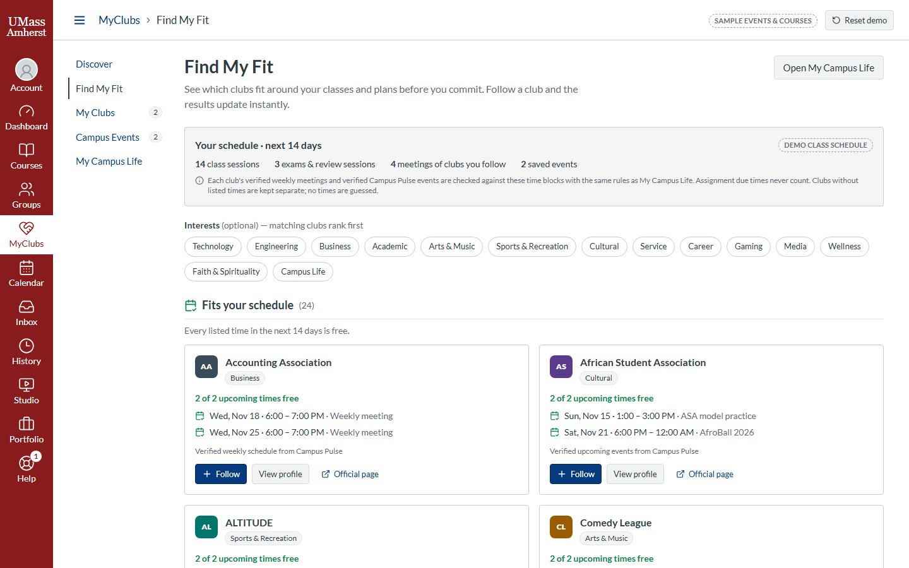

## Features

- **Find My Fit** — checks every club's verified meeting times and upcoming Campus Pulse events against your demo
  class schedule, exams, followed clubs and saved events for the next 14 days. Clubs are grouped into *Fits*, *Partial
  fit* (with the exact overlap, e.g. "Overlaps COMPSCI 235 Lab (6:30 – 8:00 PM) for 90 min"), *Conflicts* and
  *Schedule unknown*. Optional interests re-rank results. No times are ever guessed.
- **My Campus Life** — month, week and agenda views combining classes, course deadlines, club meetings and events.
  Click any item for details; real overlaps are flagged with the exact window (assignment due times never count).
- **Discover** — 78 real UMass organizations with search, category filters, sorting and source-linked profiles.
- **Campus Events** — 388 verified events from the public Campus Pulse and UMass Events Calendar feeds (official
  links, host club when known, deduplicated across sources), paged for speed, plus clearly labeled sample events.
- **My Clubs & Associations** — follow/unfollow (tracking only, not membership), upcoming activity, persistence in `localStorage`
  that stays in sync across open tabs.
- **Applications** — a personal tracker for organizations you want to join: status (Interested → Draft in progress →
  Prepared (demo) → Submitted externally → Decision received; the last two are self-reported), progress steps, the link
  you used, your own reminder date and notes. Discover can filter by membership process. **Apply** sits next to Follow
  on cards and profiles, only where an application is verified as required (or on the clearly labeled demo
  organization). It saves the organization to Applications (never twice) and opens its application form. *Applications
  closed* appears only after a verified official deadline.
- **Application forms** — a 4-step form (personal information → résumé & links → organization questions → review),
  with draft autosave, required/optional labels, character counters, friendly validation (UMass email, GitHub/LinkedIn
  profile links, PDF checks) and copy/download of your answers. Questions adapt to the organization's field through
  reusable templates: technology & engineering, business, arts & creative, media, service, sports and general.
  These are *sample application questions*; an organization's verified official requirement is shown separately.
  Résumés (PDF, up to 5 MB) stay in this browser's IndexedDB and are never uploaded. Finishing shows *Demo application
  prepared — not submitted to the organization.*
- **Canvas-style shell** — dashboard, global navigation and To Do panel matched to the real Canvas layout.

## How MyClubs differs from Campus Pulse

| Campus Pulse | MyClubs |
| --- | --- |
| Directory and official registration/RSVP | Planning layer that links back to Campus Pulse for both |
| Separate site students visit occasionally | Lives in the Canvas-style dashboard students open daily |
| Lists clubs and events | Checks clubs against *your* schedule (Find My Fit) |
| Events only | One calendar for classes, deadlines, meetings and events with conflict detection |

## Screenshots

| | |
| --- | --- |
| 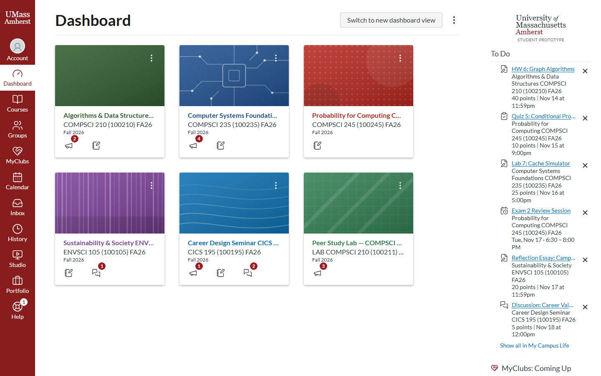 | 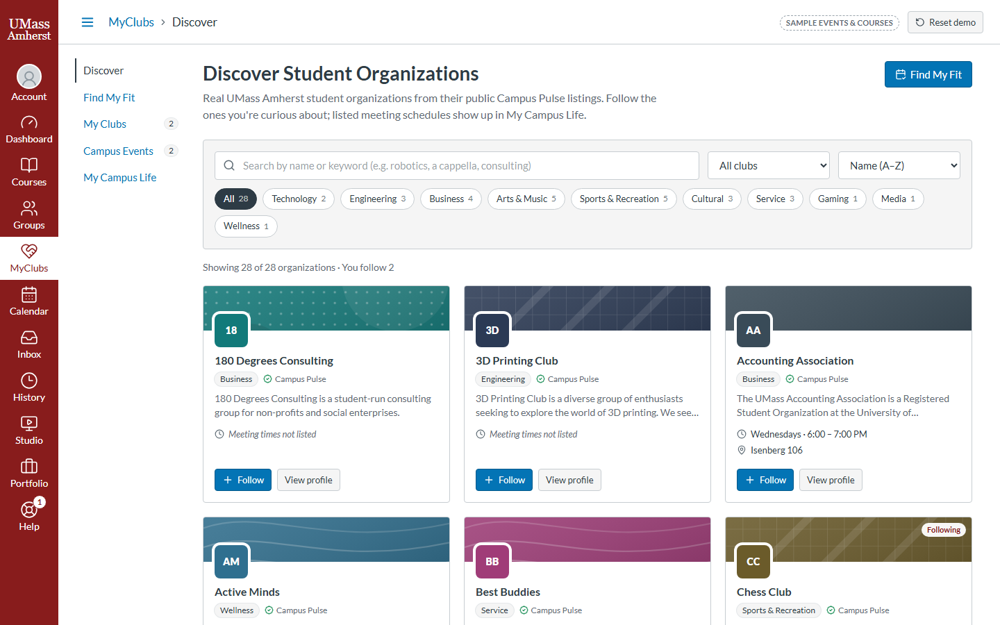 |
| 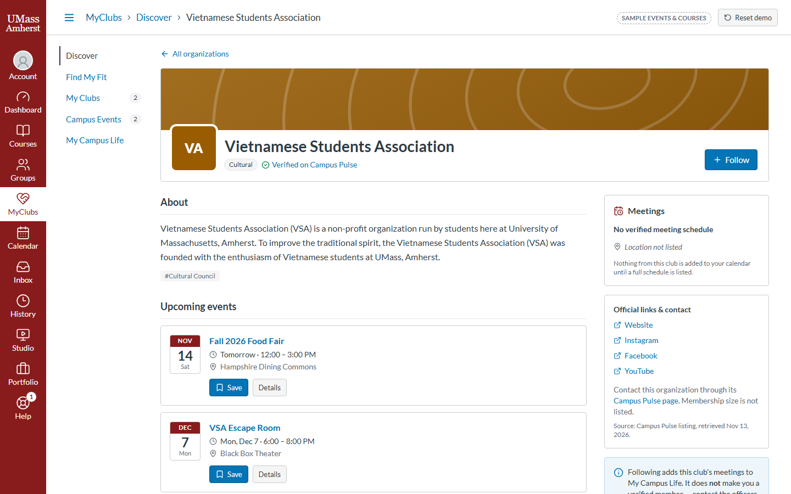 | 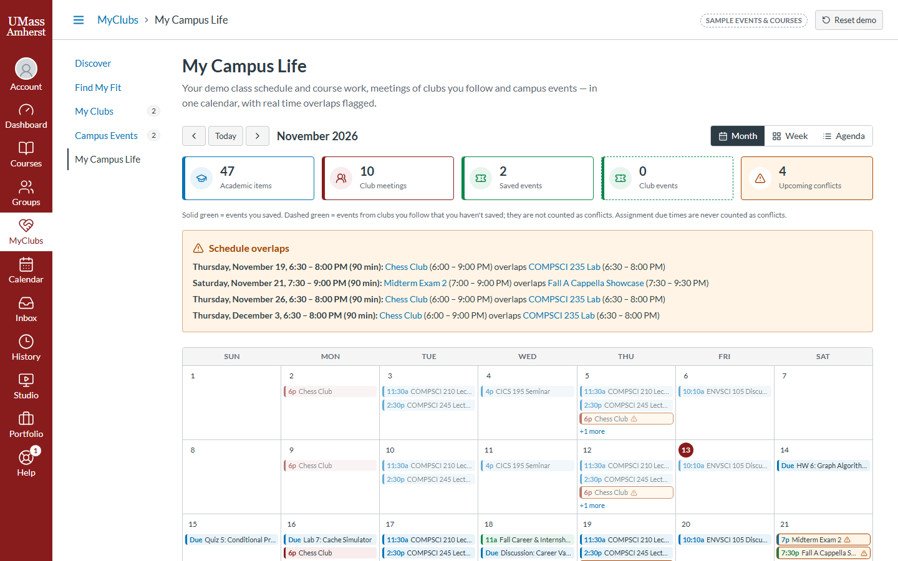 |
| 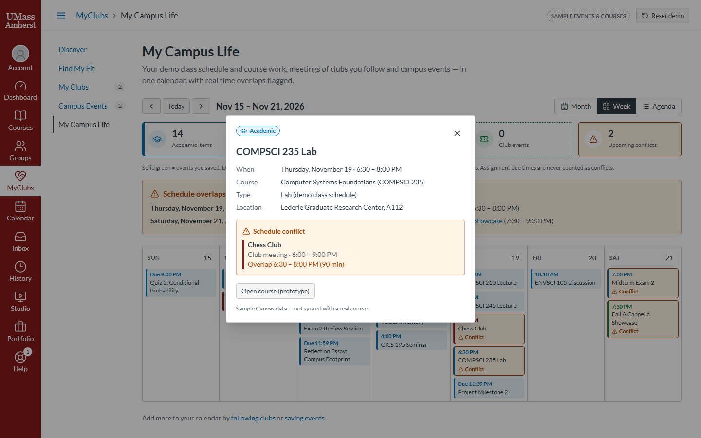 |  |
| 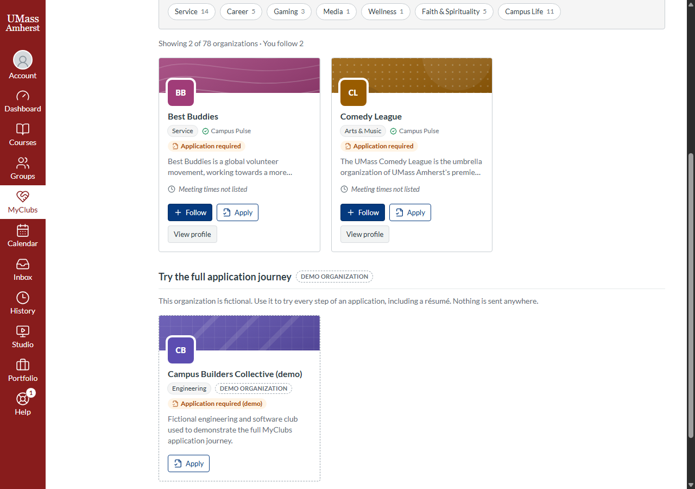 | 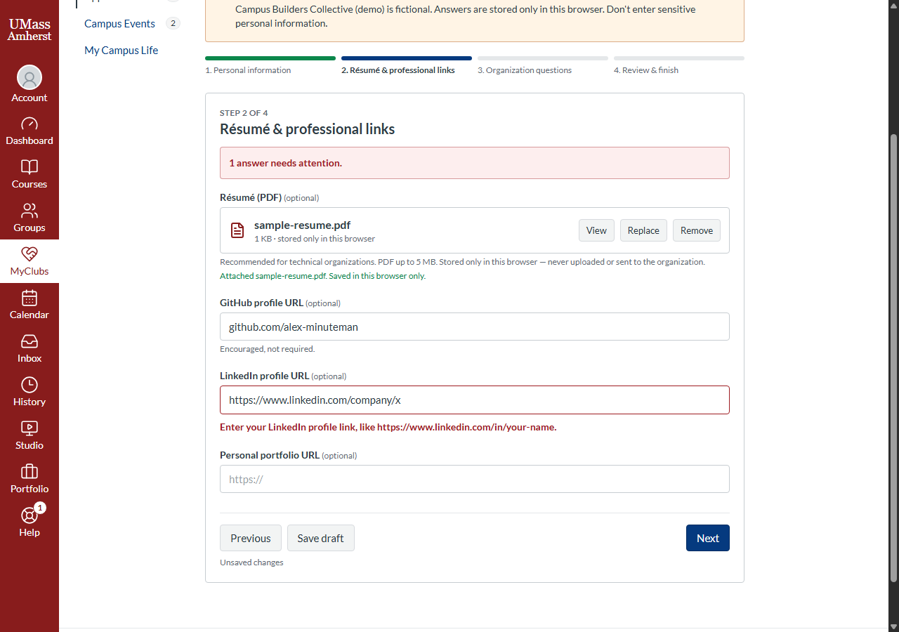 |
| 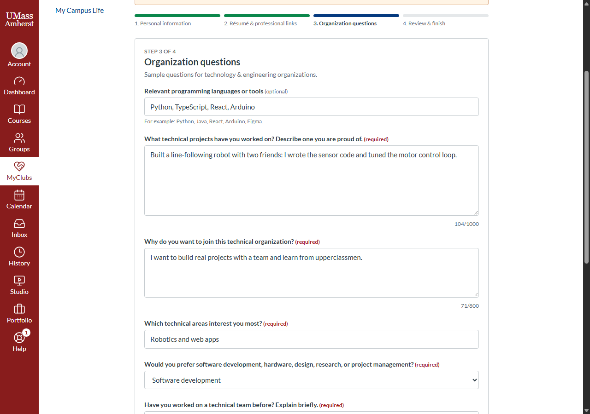 | 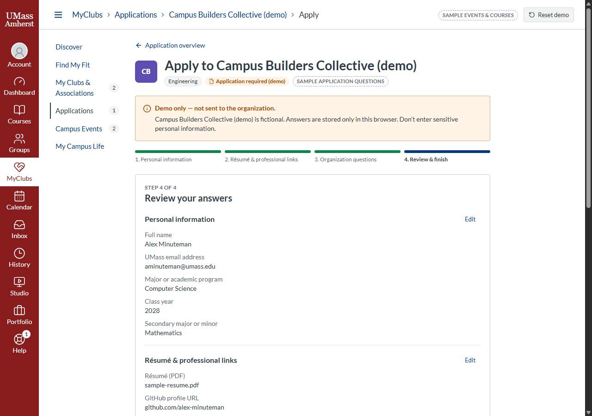 |
| 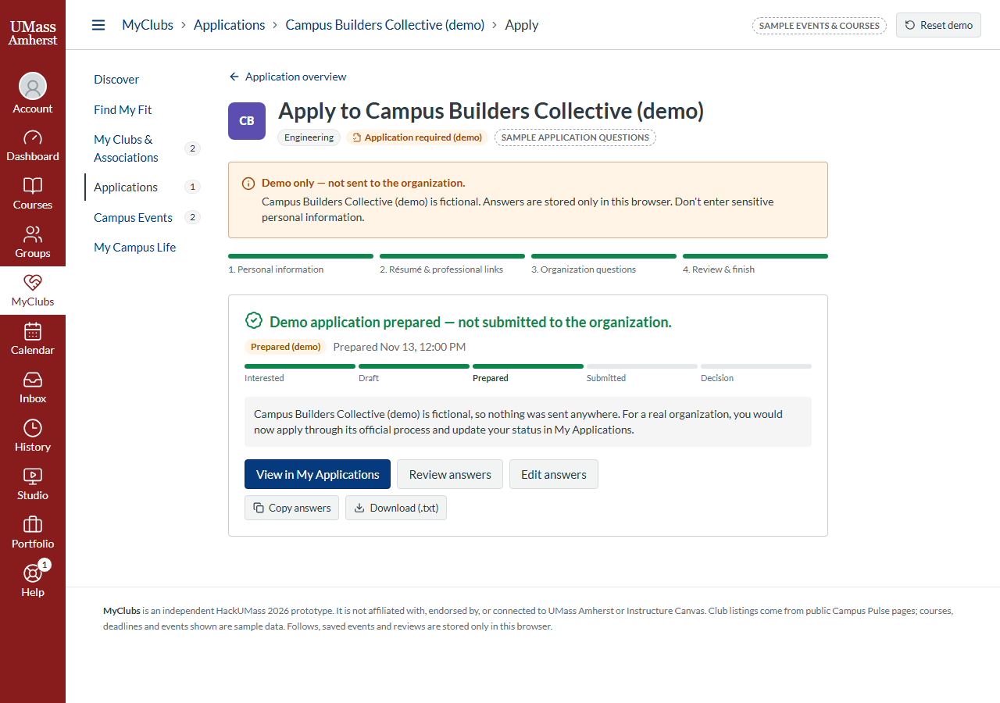 | 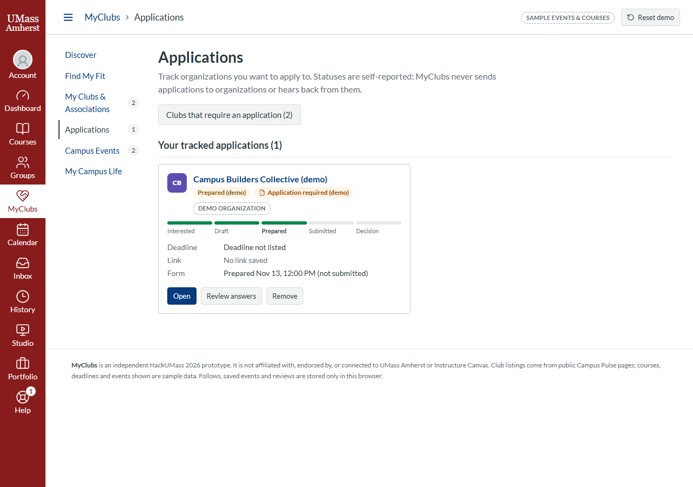 |

## Run it

```bash
npm install
npm run dev       # http://localhost:5173
npm run build     # typecheck + production build
npm run preview   # serve the production build (offline backup)
```

Use **Reset demo** in the MyClubs header to restore the demo state. Judge walkthrough: [docs/DEMO.md](docs/DEMO.md).

The demo semester (Sep 2 – Dec 10, 2026) bounds weekly classes and club meetings; override it with
`VITE_SEMESTER_START`, `VITE_SEMESTER_END` and `VITE_SEMESTER_NAME` (see `src/config/semester.ts`).

## Tests

```bash
npm test           # logic + feed tests: overlaps, deadlines, duplicates, semester bounds, feed parsing, snapshot integrity
npm run test:e2e   # browser suite (278 checks); needs `npm run dev` running and Google Chrome installed
```

Both suites use a fixed clock (default `2026-11-13T12:00:00`, America/New_York) so results never depend on today's
date. Override with `MYCLUBS_TEST_NOW`, `MYCLUBS_TEST_TZ`, `MYCLUBS_BASE_URL` and `CHROME_PATH`.

## Built with

React 19, TypeScript, Vite, Tailwind CSS v4, React Router, Lucide icons. No backend: state lives in `localStorage`.
Club and event data come from public feeds and are committed as a dated snapshot (`src/data/generated/campus-data.json`).

## Data sources and refresh

| Source | Access | Used for |
| --- | --- | --- |
| Campus Pulse public events RSS (`/engage/events.rss`) | Public subscription feed | Events, event hosts |
| UMass Amherst Events Calendar iCalendar (`events.umass.edu/calendar/1.ics`) | Public subscription feed | Events (deduplicated against Campus Pulse) |
| Campus Pulse public organization pages | Public pages | Profiles of the 28 curated clubs |
| Campus Pulse `/engage/api/` | Disallowed by robots.txt | **Not used** |
| Instagram / Facebook APIs | Need Meta app review and tokens | **Not used**; profile links only |

- `npm run sync:data` refreshes the snapshot (about 2 seconds). Vercel runs it on every deploy (`npm run build:fresh`).
  A source that fails keeps its previous data, and the UI shows each source's last successful update.
- Nothing is fetched at runtime (the feeds don't allow cross-origin requests), so the app never claims to be live.
- 28 curated organizations have full public profiles; 50 more are *event hosts* from the events feed, shown with
  their official name, verified events and a Campus Pulse link — no description, contacts or schedule are invented.

## Data and honesty

- Meeting times appear only when a listing states day, start and end time (Chess Club, Accounting Association);
  other clubs are shown as *schedule unknown* in Find My Fit, with the reason.
- No invented emails, member counts, reviews or events. Reviews are demo reviews written in your browser.
- Following a club is not membership; saving an event is not an RSVP; tracking an application never submits anything.
- Membership process is shown only when the official listing states it (quoted on the profile with its source):
  Comedy League (auditions) and Best Buddies (membership application) require one; Chess Club, Outing Club and UMass
  Gaming and Esports Club are open. No official deadlines or application links are published, so the app shows
  *Deadline not listed*; every other club shows *Application process not listed*.
- Courses, the weekly class schedule, deadlines and sample events are fictional demo data, generated relative to today.

## Project structure

```
src/
  data/        clubs.ts + verifiedEvents.ts (Campus Pulse), courses.ts + events.ts (demo)
  lib/         dates, schedule builder + overlap detection, fit.ts (Find My Fit), applications.ts (statuses, demo org),
               applicationForms.ts (form templates + validation), fileStore.ts (IndexedDB résumés)
  context/     StoreContext (follows, saves, reviews, applications), ToastContext
  components/  AppShell, GlobalNav, cards, reviews, shared UI
  pages/       Dashboard, placeholders, clubs/* (MyClubs pages)
```
